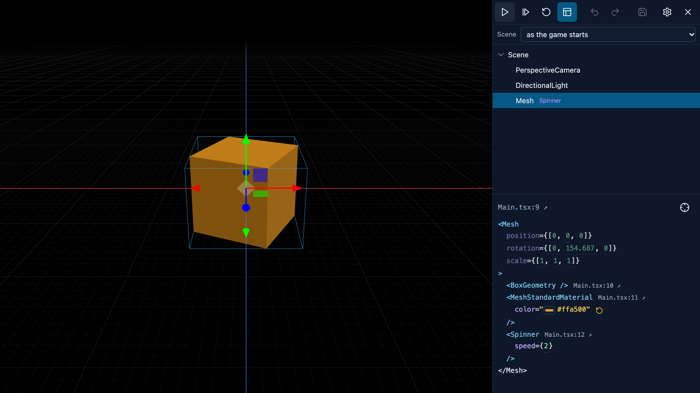

# SceNoCo

**"Scene", "Node" and "Component" combined together to represent the idea. And to book a cool name.**

An effective and lightweight framework to create web games - friendly for LLMs as well as for users.<br>
This framework gets the best ideas of three worlds: TSX scenes from [React Three Fiber](https://github.com/pmndrs/react-three-fiber),
rendering from [Three.js](https://github.com/mrdoob/three.js) and the component system from [Unity](https://github.com/Unity-Technologies/UnityCsReference).
This combination allows modern and effective game development with editable scenes, helping both developers and LLMs.

Imagine you are a developer who knows web and Unity and wanna make a game, but are burnt out because of this crazy modern world.
You open a game engine editor and it instantly feels overwhelming. Or, much worse, you're an LLM coding agent and the best 
you can get is a static image on request, anything else is just text.

**But!** Actually, you can just start with something like this:

```ts
// src/Spinner.ts — a behaviour: Unity's lifecycle, public fields are its settings
export class Spinner extends Behaviour<Mesh> {
  speed = 1;
  
  update(dt: number) {
    this.node.rotation.y += this.speed * dt;
  }
}
```

```tsx
// src/scenes/Main.tsx — a scene: every tag is the three.js class you import, built at once
export const Main = () => (
  <Scene>
    <PerspectiveCamera position={[0, 2, 5]} rotation={[-0.4, 0, 0]} />
    <DirectionalLight position={[3, 8, 5]} intensity={2} />
    <Mesh>
      <BoxGeometry />
      <MeshStandardMaterial color="orange" />
      <Spinner speed={2} />
    </Mesh>
  </Scene>
);
```

```ts
// src/main.ts
play(Main);
```

And... It just works! Intuitive, clear, predictable.

Then you hit `npm run dev`, feel proud of a spinning cube and notice the **Edit** button at the top.<br>
Click that and you can move things around and edit what the scene sets and every setting of your behaviours, live! Pretty neat, huh?<br>



Or, if you're an AI agent, you can use Playwright with simplified simulation calls, managing
the game state as you want, getting telemetry and screenshots from any angle.<br>
And besides that you have a lot of cool modules as a bonus: physics, particles, audio,
splines, terrain generation.

<details>
<summary><i>boring technical details generated by AI</i></summary>

## The whole model:

- **A tag is a class you import** and `<Mesh>` is `new Mesh()`. Attributes follow React Three
  Fiber's rules — `args` are constructor arguments, `position={[0, 1, 2]}` goes through the
  property's own `set`, `shadow-mapSize` reaches inside, geometry and material attach to their
  parent. There is no React and no reconciler: TSX builds the objects once.
- **A `Behaviour` is a component**, with Unity's hooks (`awake`, `start`, `update`, `fixedUpdate`,
  `onDestroy`, …), coroutines, `Time`, `Input`, `instantiate`, `destroy`, `findObjectOfType`,
  `SceneManager`.
- **A prefab is `prefab(() => …)`** around a function returning TSX; `instantiate(Prefab)` calls it,
  and its tag places and names it like a Unity instance.
- **A scene only declares.** Logic lives in behaviours. `scenoco check` refuses loops, branches and
  calls in a `.tsx` file and says what to write instead — which is what keeps a scene editable by a
  tool as well as by hand.
- Everything else is three.js, as three.js documents it — the renderer, post-processing, loaders.

`tsc` checks all of it: a misspelled attribute, a wrong value type, a lowercase tag and a ref of the
wrong class are type errors at the line they were written on.

## Start a project

```bash
npm create @scenoco-three my-game
cd my-game && npm install && npm run dev
```

A block you steer, crates you drop, a camera that follows — every verb a behaviour has, in four short
files — and an `AGENTS.md` that says the whole model in a page, including how an agent drives the
running game from its browser tool.

## Packages

| Package | Description |
| --- | --- |
| [`@scenoco-three/core`](packages/core) | `Behaviour`, the TSX runtime, `play`, `SceneManager`, `Time`, `Input`, coroutines, events, asset loading. [Its whole API on one page.](packages/core/API.md) |
| [`@scenoco-three/rapier`](packages/rapier) | 3D physics on Rapier, in Unity's shape: `Rigidbody`, `BoxCollider`, `onTriggerEnter`. |
| [`@scenoco-three/box2d`](packages/box2d) | 2D physics on planck: `Rigidbody2D`, `BoxCollider2D`, `onCollisionEnter2D`. |
| [`@scenoco-three/particles`](packages/particles) | Unity's `ParticleSystem` on three.quarks. |
| [`@scenoco-three/audio`](packages/audio) | Unity's `AudioSource` on three.js's Web Audio. |
| [`@scenoco-three/splines`](packages/splines) | Unity's Splines: tracks, rails and roads — meshes bent along a curve, prefabs placed by it, objects driven on it. |
| [`@scenoco-three/terrain`](packages/terrain) | Unity's `Terrain` and `TerrainData`: ground from a heightmap, layers blended by weight, made in code or loaded from a compact file. |
| [`@scenoco-three/unity`](packages/unity) | `scenoco-unity`: a game written into a Unity project — prefabs, scenes, meshes, materials, particles, the page as UI Toolkit, the input actions — with C# stubs holding its TypeScript, and commands that drive it in Play mode. |
| [`@scenoco-three/tools`](packages/tools) | `scenoco check` — a scene only declares — and the read/edit layer an editor uses on scene files. |
| [`@scenoco-three/create`](packages/create) | The starter `npm create @scenoco-three` copies. |
| [`@scenoco-three/editor`](packages/editor) | A visual editor over the running game in development — a button on the page — that writes edits back into the `.tsx` files byte for byte. |

## Testing it, or letting an agent look

In development `play()` installs `window.__scenoco` in the page, and any browser tool can drive the
running game with it — Playwright's `page.evaluate`, an agent's browser tool, the console. It holds
the clock and steps exact frames, presses keys, clicks and swipes, waits for a condition and reads
behaviours by class: `__scenoco.until("GameState.phase === 'over'")`. `__scenoco.help()` lists the
rest.
A tool that can't run JavaScript in the page — only open an address, read the console and take a
screenshot — drives it from the address instead: `/?drive=press('Space');until(Game.over);outline()`.
The address carries data, not code, so a link from anywhere can do no more than press keys.

The game's rules are tested without a browser at all: `simulate(Main)` runs the scene in Vitest, in
Node or jsdom, and the test steps it, presses keys and checks the result frame by frame.

For an agent making a game, [`skills/scenoco-game`](skills/scenoco-game/SKILL.md) is the workflow as a skill:
read the rules card, write, `npm run check`, then play it through `__scenoco` until each phase is proven.

## Editing a scene by hand, visually

```bash
npm run dev            # the game, as always — then Edit on the bar along its top
```

The editor opens over the running game: pause it, step it, or reset to its first frame; the scene's
nodes, and the selected one shown as its TSX with live values and a gizmo. Save writes the changes
into the `.tsx` files they came from, one attribute at a time, everything else byte for byte. See
[`packages/editor`](packages/editor).

## This repo

```bash
npm install
npm run build          # every package, in dependency order
npm run examples:dev   # examples/breakout
npm test               # vitest, under tests/{core,packages,tooling}
npm run typecheck      # tsc over every package and the tests, then each example's and the starter's own check
```

Working *on* this repo with an agent? Start at [`AGENTS.md`](AGENTS.md).

</details>
<br>

## Examples

I know you wanna look at something real made with this thing. 
The first example you can see in this repo is [its own homepage](https://romarogov.github.io/scenoco-three/), which you can inspect with the "Source" button or view the code at [`examples/home`](examples/home).

More playable stuff is also there:
- [**Breakout**](examples/breakout) ([play](https://romarogov.github.io/scenoco-three/breakout/)) — three levels, Box2D, an HTML HUD, bloom.
- [**Tiny Bastion**](examples/td) ([play](https://romarogov.github.io/scenoco-three/td/)) — tower defence on a layered terrain: paths, towers, particles,
  sound, a menu and levels.
- [**Spline Race**](examples/race) ([play](https://romarogov.github.io/scenoco-three/race/)) — a closed track: one modelled road piece bent along a spline,
  lamps and trees placed along it, cars driving it.
- [**Eggy Roll**](examples/eggy) ([play](https://romarogov.github.io/scenoco-three/eggy/)) — a Unity game ported: its terrain generated at runtime, Rapier
  physics tuned against the original's.

All these games were written by Claude and polished with the editor UI from a couch — I just used a tablet to play around with things.

## Why?

Well, I've been a game developer [for a while already](https://www.linkedin.com/in/romarogov), specialized mostly in mobile and casual games.
And although AI has definitely been interesting to me since I giggled at DeepDream's trippy doggies
in 2015, all this LLM coding hype hit me as suddenly and as hard as it hit you, my dear visitor,
despite the fact that I spend a lot of time on analysis and experiments in that area.

Over the years that I've been watching game generation attempts with LLMs, I was really annoyed by
one problem which still remains: what should we do with the output? Now it's mostly unreadable
garbage, which just takes more and more tokens with every edit, not to mention real development with
human hands.

So, here I am, presenting my take on the question of how things can be done differently.

## And what do LLMs have to do with this?

LLMs are fluent in TypeScript, TSX and their concepts, thanks to the huge World Wide Web. They're also
fluent in Unity scripting, just not the scenes — those are mostly a proprietary mess. This framework
gives the model clear associations in all the required areas: no new DSL, no new patterns, just a
mix of the realities, and it turns out that when the harness is done right, it does just
what you asked it for without spending all your budget on architectural decisions.

The result can be converted from web to Unity semi-automatically. All logic gets its
place in specific behaviours, which are easy to find and change. You get control of the process back
and can actually see what's happening.

## The status

Currently I came to a point where tests and use cases shows no requirements to change the API. There 
may be a bit of bugs or places where performance can be improved, but structure itself holds still, so
feel comfortable to use it for your next project and leave an issue if you've noticed something.

I've spent 4 months of my free time with our good old buddy Claude on prototypes, experiments and
tests of different hypotheses. 

The latest implementation is the one I decided to keep as a viable solution, because this is the first
codebase I'm actually satisfied with. And, yes, I'm still reading all the code produced by AI.
And you are welcome to inspect it too. I've tried to make the idea simple, yet used AI to write the 
actual code — hope it's fine nowadays.

## What you can use instead and why I didn't

[React Three Fiber](https://github.com/pmndrs/react-three-fiber) is great tech, and LLMs know it really well, no doubt. But it's still a framework
for UI, not games. React creates a really bad habit — LLMs start to describe the whole game in
reactive terms and hooks, and smear behaviour logic between visuals. So while the results are better
than one `.js` file from a vanilla Three.js run, they are still unacceptable, and no good rule can
break the model's habits, so I just dropped my attempts to make R3F good for games.

[Needle Engine](https://github.com/needle-engine) shares the idea of combining the web and game engines, including Unity. But it's a set of tools which covers A LOT of cases, and it's mostly a service rather than a game development base — you'd better pay for a subscription to get the most of its ecosystem.

For agents: [`llms.txt`](https://romarogov.github.io/scenoco-three/llms.txt) and
[`llms-full.txt`](https://romarogov.github.io/scenoco-three/llms-full.txt) list every document, and
[`packages/core/API.md`](packages/core/API.md) is every signature on one page.

## License

[MIT](LICENSE)
