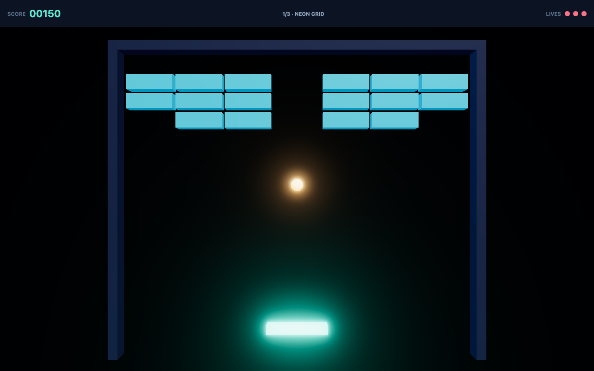

# Breakout

Three levels of Breakout on SceNoCo: scenes in TSX, behaviours in TypeScript, the HUD in HTML. It
exists to be *built* rather than admired: everything in it is the ordinary way to do the thing, so
where the engine makes that hard, the awkwardness is visible in the source.



```bash
npm --prefix examples/breakout run dev
```

Drag or use ←/→ (or A/D) to move the paddle, click or press space to launch.

## How it is put together

| | |
| --- | --- |
| `src/main.ts` | `play(Run)`, and the look: filmic tone mapping, and bloom over a multisampled HDR target |
| `index.html` | the HUD — score, stage, lives, combo, running bonuses, floating points, the banner between rounds |
| `src/scenes/Run.tsx` | the run: `Progress` and the list of levels, kept across every level load |
| `src/scenes/levels.tsx` | one `Level` scene function, and three levels, every brick placed by hand |
| `src/scenes/Arena.tsx` | what every level shares: backdrop, walls and their neon, the paddle, the ball, the floor |
| `src/scenes/prefabs.tsx` | brick, ball, laser bolt, the four pickups, and the sparks things break into |
| `src/textures.ts` `src/vfx.ts` | canvas-drawn neon maps, as texture tags; particle effects as data |
| `src/Progress.ts` `src/GameState.ts` | the run and the HUD; one level's rules, balls and combo |
| `src/Ball.ts` `src/Paddle.ts` `src/Brick.ts` `src/Pickup.ts` `src/Bolt.ts` | the moving parts |
| `src/CameraRig.ts` | the camera behind the paddle: parallax, fov fitted to the field, trauma shake |
| `src/Music.ts` `src/Sfx.ts` | the music, following the game, and the sound effects — on the run's scene, kept across levels |
| `src/sound/` | a Mega Drive's two chips (YM2612 FM and PSG, from `tetorica-fm2612`), the patches, the song, the effects |
| `src/GridSnap.ts` `src/Spin.ts` `src/Lifetime.ts` `src/Floor.ts` `src/layers.ts` | small helpers, Unity's tag, and the physics layers |

A few things carry most of the weight:

- **The run outlives the level.** `play(Run)` loads the run first; `Progress` calls
  `dontDestroyOnLoad(this)` in `awake` and then `SceneManager.load(Level1)`. A level load
  destroys the level before it and leaves the run alone, so the score is never copied anywhere.
- **The HUD is the page.** `Progress` writes `textContent` into `index.html`'s elements. The banner
  between rounds is `<div data-button="Continue">`: a tap on it is `Input.getButtonDown('Continue')`
  on the next frame, sampled like a key rather than handled between frames.
- **A level is a scene function with props.** `<Level title="FORTRESS" ballSpeed={16} wallY={14.4}>`;
  the pace is a rule of the level, on its `GameState`, which every ball reads.
- **Bonuses are prefabs.** A brick placed with `bonus="laser"` wears a gem in the bonus's colour and
  drops `LaserPickup` when it breaks; the paddle catches it — laser cannons, three balls, wide or
  slim — and a lost ball ends them.
- **A level is built in the editor, not in code.** Each brick is its own element,
  `<BrickPrefab position={[2.55, -1, 0]} hits={2} bonus="multi" />`, so a designer drags bricks into
  place and sets `hits` and `bonus` in the editor — ⌘D for another, ⌫ to take one out — and the
  file says what they did. `GridSnap`'s `onValidate` keeps a dragged brick on the wall's grid;
  `snap={false}` on one brick lets it sit between cells.
- **A scene declares, a behaviour chooses.** The brick prefab hands `Brick` its tables —
  `tints={[…]}`, `bursts={bursts}`, `drops={pickups}` — and the brick picks from them by its
  `hits` and `bonus`: picking is logic, and logic is a behaviour's.
- **The camera keeps the field's width, not a fov.** `CameraRig` sits behind the paddle, fits its fov
  so the walls stay on screen at the paddle's line on any window, drifts after the paddle and the
  ball for parallax, and shakes by trauma — `GameState.impact` is an `Event` it listens to.

- **The music is played, not recorded.** A Mega Drive's YM2612 and PSG, emulated in WASM
  (`tetorica-fm2612`, ~70 KB gzipped — less than one MP3 loop), render a tracker song a fifth of a
  second ahead of what is heard. `Music` reads the level every frame: the drums come in on launch, metal
  arpeggios with a combo or half the wall gone, the lead near the end; each stage changes key, the last
  three bricks speed it up, a lost ball drops it, a banner muffles it. Effects render once on chips of
  their own, in the stage's key, and a rally's breaks climb the scale. **M** or the button mutes it.

Bricks register with `GameState` in `awake` (found with `findObjectOfType`), so nothing queries the
scene and no list of bricks is wired by hand. `GameState` finds the kept `Progress` the same way.

## What the engine still makes awkward

- **Nothing reports a brick that is unreachable.** A level whose map puts a brick behind a wall can
  never be cleared, and the first sign is a player waiting for a banner that never comes.
